<a href="https://maique-moraes.vercel.app">
  <picture>
    <source media="(prefers-color-scheme: dark)" srcset="./assets/banner-dark.svg">
    
  </picture>
</a>

I build TypeScript products end to end with React, Next.js, Node.js, and NestJS, and I integrate LLMs, retrieval, and MCP tools into real business workflows. I've spent 6+ years on products for procurement, logistics, financial services, and healthcare, and I'm currently a Senior Full Stack Developer at Stratesys.

**[Website](https://maique-moraes.vercel.app)** · [LinkedIn](https://www.linkedin.com/in/maique-moraes/) · [Resume (PDF)](https://maique-moraes.vercel.app/maique-moraes-resume.pdf) · [Email](mailto:maiqued.18@gmail.com)

### Case studies

Three problems from production, and the decisions behind them:

- **[A bid comparison you can trust](https://maique-moraes.vercel.app/work/bid-comparison)**: a NestJS backend-for-frontend that refuses to show an incomplete comparison as valid.
- **[AI assistants that work inside the rules](https://maique-moraes.vercel.app/work/ai-in-business-workflows)**: retrieval for documents and MCP tools for live data, with permissions enforced by the services, not the model.
- **[Evolving a financial platform without breaking trust](https://maique-moraes.vercel.app/work/financial-platform)**: single-spa microfrontends, a shared design system, and tests that protect existing behavior.

### Public repositories

Most of my production code lives in private company repositories. Here's what's public:

- **[maique-moraes](https://github.com/cybermaique/maique-moraes)**: the source of my website. Next.js 16, React 19, TypeScript, English and Portuguese, interactive diagrams, Playwright and axe tests.
- **[repopilot-ai](https://github.com/cybermaique/repopilot-ai)**: an evidence workspace for exploring repositories. You ask a question, then open the cited file at the exact snapshot and lines. Early stage; runs locally.
- **[TruckTracker](https://github.com/cybermaique/trucktracker)**: a take-home challenge. A React and TypeScript fleet app with Leaflet maps, proximity sorting, and tests. [Live demo](https://trucktracker-inlog.vercel.app).

### Writing

- **[A green pipeline, an unhealthy app](https://maique-moraes.vercel.app/notes/green-pipeline-unhealthy-app)**: what a CI pipeline actually proves, and what it doesn't.

### How I work with AI

I use Claude Code, Codex, and GitHub Copilot every day to explore code, test, and review, and I stay accountable for every line that ships. My website was built this way. Its [agent instructions and commit history](https://github.com/cybermaique/maique-moraes) are public.

João Pessoa, Brazil · UTC−3 · Flexible hours for overlap with teams in the Americas and Europe
